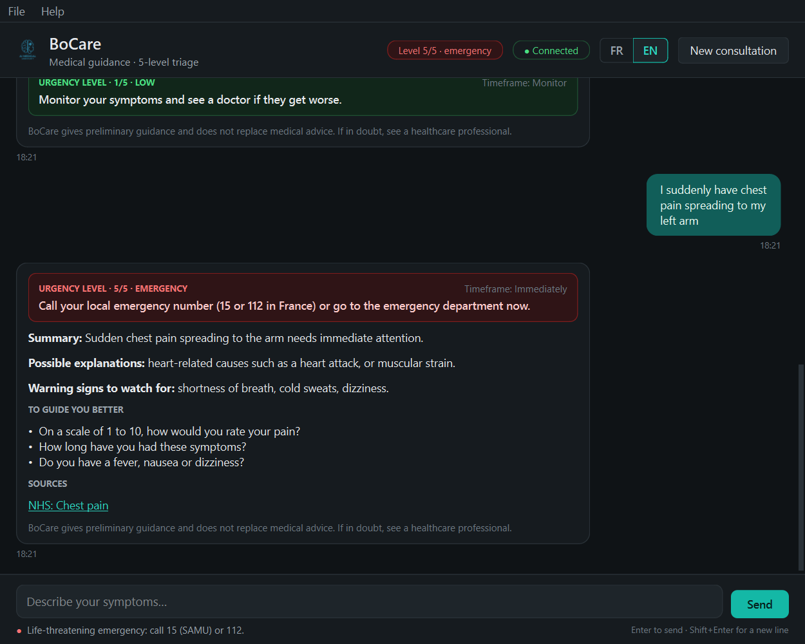

# BoCare 2.0

A medical guidance assistant. You describe your symptoms in French or English, and it tells you what kind of care to seek, from "monitor at home" to "call emergency services now".

BoCare 2.0 is a rebuild of a prototype I wrote in 2025 (BoCare 1.0). I took my own early prototype and reworked it with current AI engineering practices. The goal was something that can be **deployed** behind an API, **tested** without a network or a GPU, **explained** step by step, and **defended** when someone asks "why did it say that?". Both versions are described below.


*Desktop client, rendered with sample responses.*

## From 1.0 to 2.0 at a glance

| | BoCare 1.0 (2025) | BoCare 2.0 |
| --- | --- | --- |
| **Architecture** | One PyQt6 app; UI, prompts, scraping and LLM calls mixed together | FastAPI backend with a staged pipeline; the PyQt6 app is a client of the API |
| **Who decides urgency** | Keyword rules, but the model also gave its own level, and the UI read the level by searching the reply text | Rules only. The model is told the result and has to stay consistent with it. The level is returned as a typed field. |
| **LLM** | Mistral-7B through OpenRouter; API key had to be pasted into `config.py` | Local Qwen3 8B through Ollama, with Qwen3 4B as fallback; OpenRouter still available. Settings come from `settings.yml`, overridable from `.env`. |
| **Self-harm message** | Refused as "inappropriate content" | Answered with crisis lines (3114 in France) and flagged as urgency 5 |
| **"I took an overdose"** | Level 1, "monitor your symptoms" | Level 5, "call 15 / 112 now" |
| **Emergency warning** | Detected, but only written to the log | Shown to the user before the reply |
| **Sources** | HTML scraping of Mayo Clinic, NHS and MedlinePlus (later blocked: 403/404), plus an Ameli "source" whose text was a hard-coded placeholder | Semantic search over the full MedlinePlus corpus (1,016 topics, 3,524 chunks) with a multilingual embedding model; French questions find English pages. Measured on 38 patient messages: 79% of the right pages retrieved, vs 39% for keyword search. Citations that match no source are removed. |
| **Output handling** | Free text, plus a regex "hallucination fix" that could reverse meaning ("I cannot provide…" became "The information suggests") | JSON matching a schema, with each explanation citing source IDs. It's checked before display: no delay advice at level 4-5, no doses, no diagnostic certainty, plus an LLM judge from level 3. One regeneration, then the fixed recommendation. |
| **Configuration** | Values scattered through the code; the API key had to be pasted into `config.py` | Every rule, threshold, text and prompt in validated YAML files; a broken file stops the server at startup with the file and field named |
| **Privacy** | Raw symptom text written to a log file | Logs hold the triage outcome and a request ID, never the message text |
| **Tests** | None | 153 automated tests (unit, safety, API integration, UI), running offline with a mocked LLM and retriever |
| **Latency** | One blocking call; nothing on screen for 20-40 s | Staged streaming: triage and recommendation in under 0.5 s, then sources, progress updates and the verified answer |
| **Interface** | Whole reply in one coloured bubble; text clipped on long messages | Structured card (safety banner, triage panel, explanations with clickable citations, warning signs, follow-ups, sources); connection and urgency status in the header |

## Design decisions

These are the choices I'd defend in a review:

1. **The model explains; it doesn't decide.** Urgency comes from deterministic, readable rules ([triage.yml](backend/app/config/triage.yml)). For an emergency, the same input always gives the same level, whatever the model writes. The model receives the level and recommendation, and at levels 4-5 it's told not to suggest waiting.
2. **Triage survives an LLM outage.** If the model is down or times out, the API still returns the urgency level, the recommendation and follow-up questions. Only the explanation is missing.
3. **Safety cases are answered, not blocked.** Self-harm and prescription requests are flagged and get a fixed, checked message. Only abuse (prompt injection, flooding, oversized input) is rejected.
4. **Local model by default.** Health data stays on the machine. Qwen3 8B fits in 8 GB of VRAM. The model is loaded at server start so the first user doesn't wait for it, and the 4B fallback takes over if the 8B fails.
5. **Fixed replies where no AI is needed.** "hi", "merci" and "can you help me?" get an instant fixed reply instead of a 30-second generated one that would invent symptoms.
6. **Honest naming.** 1.0 had a "hallucination detector" and a "medical accuracy score" that were really keyword counts; I removed them. The README lists what doesn't work yet.
7. **Nothing generated reaches the patient unchecked.** The model answers in JSON. Rules reject delay advice at levels 4-5, doses and diagnostic certainty, and from level 3 a judge (the same model, to stay within 8 GB of VRAM) checks that claims match their cited sources and don't downplay the recommendation. A rejected draft is regenerated once with the reason; a second failure shows only the fixed recommendation. Failure codes are logged and returned, never the text.
8. **Stream what's safe, hold what isn't.** Token streaming would show text before it is verified, so streaming is staged instead: the triage, which needs no model, appears in under half a second, and the explanation appears only after verification.
9. **Behaviour lives in configuration, logic in code.** Triage rules, care paths, safety phrases, verification patterns, prompts, UI texts and colours are YAML files, each with a schema. Adding a symptom or adjusting a threshold changes a file a clinician can read, not Python. Settings can be overridden per machine with environment variables.
10. **Interfaces at the boundaries.** The retriever and the LLM client are small interfaces, so tests use fakes. Replacing web scraping with a vector index later won't touch the pipeline.

## How a message is handled

`POST /chat` runs the pipeline in [backend/app/pipeline/orchestrator.py](backend/app/pipeline/orchestrator.py) (details in [backend/README.md](backend/README.md)):

1. **Preprocessing**: detect French or English (a session follows the language the user writes in), and catch greetings and thanks.
2. **Safety** ([safety.py](backend/app/pipeline/safety.py)): length limits, per-session rate limiting, a heuristic filter for obvious prompt-injection attempts, and self-harm and prescription flags.
3. **Triage** ([triage.py](backend/app/pipeline/triage.py), rules in [triage.yml](backend/app/config/triage.yml)): keyword rules give an urgency level from 1 to 5, which never goes down within a session.
4. **Response** ([responder.py](backend/app/pipeline/responder.py)): the message is embedded with `qwen3-embedding` and the closest MedlinePlus passages are found in a local vector index ([dense.py](backend/app/retrieval/dense.py)), then sent to the model with the conversation and the triage result.
5. **Verification** ([verifier.py](backend/app/pipeline/verifier.py), patterns in [verification.yml](backend/app/config/verification.yml)): the JSON answer is cleaned ([postprocessor.py](backend/app/pipeline/postprocessor.py)), then checked by rules and, from level 3, by a judge. It is regenerated once if rejected, and replaced by the fixed recommendation if rejected again.

## Project structure

```text
backend/
  app/
    api/            routes: /chat, /chat/stream, /health
    core/           settings, config_loader (YAML loading + validation), logging, request IDs, errors
    config/         YAML: settings, triage rules, care paths, follow-up questions, safety,
                    verification patterns, conversation texts, search glossary
    prompts/        YAML: answer and judge prompts, separated from the code that sends them
    schemas/        Pydantic contracts: API, LLM answer, and every config file
    pipeline/       orchestrator, preprocessor, safety, triage, follow-ups, responder,
                    verifier, postprocessor
    llm/            Ollama and OpenRouter clients, prompt builders
    retrieval/      corpus parsing and chunking, embeddings, vector index, semantic retriever;
                    MedlinePlus keyword retriever (fallback)
  data/             processed/chunks.jsonl (versioned); raw/ and index/ are rebuilt by scripts/
  tests/
    unit/           pipeline steps, config validation, LLM client, retriever, schemas
    safety/         behavioural safety checks on input validation
    integration/    API and streaming tests with a mocked retriever and LLM
scripts/            build_corpus.py, build_index.py
evaluation/
  retrieval/        38 labelled patient messages, run_retrieval_eval.py, results per retriever
desktop/
  config/           YAML: settings, FR/EN texts, colours; Qt stylesheet
  tests/            offscreen UI tests
assets/             logo, screenshot
```

Each part has its own README: [backend](backend/README.md), [configuration](backend/app/config/README.md), [desktop](desktop/README.md). Installation and troubleshooting are in [SETUP.md](SETUP.md).

## API

`POST /chat`

```json
{"session_id": null, "message": "J'ai mal à la tête depuis deux jours", "language": "fr"}
```

Omit `session_id` to start a session, then reuse the one returned. The response contains:

- `session_id`, `language`, `reply`
- `urgency_level` (1-5)
- `recommendation` (`text`, `timeframe`; `null` for blocked messages and small talk)
- `follow_up_questions`
- `sources` (`title`, `url`)
- `safety_status` (`status`: `ok` / `flagged` / `blocked`, plus `flags` and `messages` to show before the reply)
- `disclaimer`
- `answer`: the verified structured answer (`summary`, `possible_explanations` with `source_ids`, `warning_signs`, `self_care`, `clarifying_question`), or `null`
- `verification`: `status` (`passed`, `regenerated`, `fallback`, `llm_unavailable`) and `failed_checks`

`POST /chat/stream` takes the same body and returns server-sent events:

- `triage` (urgency, recommendation, safety messages and follow-up questions, under 0.5 s)
- `sources`
- `status` (`retrieving`, `generating`, `verifying`, `regenerating`)
- `done`, with the same body as `POST /chat`

The desktop client uses this endpoint.

`GET /health` returns `{"status": "ok", "llm_configured": true|false}`. Interactive docs are at `http://127.0.0.1:8000/docs` while the server runs.

## Running it

Requires Python 3.10+ and [Ollama](https://ollama.com). Full instructions and common problems: [SETUP.md](SETUP.md).

```bash
pip install -r requirements.txt
ollama pull qwen3:8b && ollama pull qwen3:4b && ollama pull qwen3-embedding:0.6b
python scripts/build_corpus.py --download && python scripts/build_index.py
uvicorn app.main:app --app-dir backend     # backend on http://127.0.0.1:8000
python -m desktop.main                      # desktop client, in a second terminal
pytest                                      # 153 tests, no network or GPU needed
```

## Limitations

- **Triage is keyword-based and not clinically validated.** It misses symptoms described in unexpected words and can over-react to words like "persistent".
- **Retrieval is weaker in French** (61% vs 95% in English on our evaluation set) and has no relevance threshold yet, so a loosely related page ("Throat Cancer" for a scratchy throat) can be sent as a source. Hybrid search, a reranker and query translation are next.
- **Emergency numbers are French** (15, 112, 3114). Deploying elsewhere means changing them in `care_paths.yml` and `safety.yml`.
- **Sessions and rate limits live in memory**, so they are lost on restart and limited to one process.
- **Verified answers take 15-30 s** with qwen3:8b on an 8 GB laptop GPU (JSON generation plus, from level 3, the judge). The triage itself appears in under 0.5 s.

## Roadmap

1. Hybrid search (BM25 + embeddings), a cross-encoder reranker, a relevance threshold and query translation, measured against the same evaluation set.
2. Build an evaluation set of labelled triage cases and track the under-triage rate in CI.
3. Add Docker, persistent sessions and Arabic.

---

## BoCare 1.0 (2025, original prototype)

The first version was a single PyQt6 desktop application, built as a personal project in 2025:

- French and English chat interface with a dark theme, coloured by urgency
- 5-level triage from symptom keywords, mapped to care paths (from self-monitoring up to SAMU / 15)
- Follow-up questions to gather more details
- Answers from Mistral-7B-Instruct through OpenRouter
- Context scraped from Mayo Clinic, NHS, MedlinePlus and Ameli
- Regex filters for jailbreak and injection attempts, and a response "quality score"
- Session export to JSON

It proved the idea worked. It also had the problems that 2.0 fixes, listed in the comparison table above:

- safety gaps: self-harm messages refused, overdose triaged as low urgency, emergency warnings never shown
- no tests
- a missing API key that stopped the app from starting
- logic that couldn't be reused outside the desktop window

1.0 is kept as the starting point of this project's history. The migration happened in steps:

1. Clean-up and safety fixes.
2. Extract the FastAPI backend and turn the desktop app into a client.
3. Switch to a local LLM and add output guards.
4. Redesign the interface.

## Disclaimer

BoCare is a personal project for learning purposes. It is not a medical device and does not replace professional medical advice. In an emergency, call your local emergency number (15 or 112 in France).
